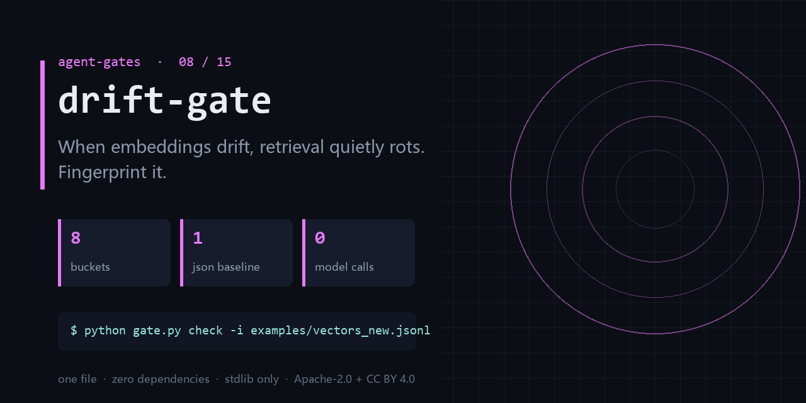

<div align="center">

</div>

<h1 align="center">drift-gate</h1>

<p align="center"><b>When embeddings drift, retrieval quietly rots. Fingerprint it.</b><br><sub>one file · zero dependencies · stdlib only</sub></p>

<p align="center">  </p>

---

## The failure this catches

- You swapped the embedding model and retrieval quality slid for two weeks before anyone noticed.
- 'Search feels worse' cannot be falsified — there is no baseline to compare against.
- Upstream changed the dimension, the vector store accepted it, and every distance is now wrong.

One command, on a file you already have:

```bash
python gate.py build -i examples/vectors.jsonl -o examples/baseline.json && \
  python gate.py check -i examples/vectors_new.jsonl -b examples/baseline.json --threshold 0.2
```

<details>
<summary><b>Real output</b> — produced by the bundled <code>examples/</code>, not a mock-up</summary>

```text
drift_score=0.474919 mean_tvd=0.342187 worst_dim=3 alert=true
```

</details>

## What it does

- Fingerprints an embedding distribution into a compact, diffable JSON baseline.
- Detects both distribution drift and silent dimension changes.
- No model, no vector DB, no network — pure arithmetic over JSONL.

## What it does **not** do

- It does not produce embeddings; feed it vectors you already have.
- Drift is not quality. A drifting distribution can still retrieve well.
- The threshold is yours to calibrate — the tool has no opinion on 0.2.

Being explicit here is cheaper than a wrong expectation later.

## Exit codes

`0` = clean, `1` = findings. Gate your pipeline on `$?`.

## Install

```bash
git clone https://github.com/chenhz01/drift-gate
cd drift-gate
python gate.py --help
```

Python 3.9+. Nothing to `pip install` — stdlib only.

## Use it in CI

```yaml
- name: drift-gate
  run: python gate.py check -i examples/vectors_new.jsonl -b examples/baseline.json --threshold 0.2
```

`action.yml` is included, so you can also reference the repo directly as a composite action.

## 中文速览

**嵌入漂移门** — 嵌入一漂，检索就在悄悄烂掉——先建指纹，再设阈值。

- 换了 embedding 模型版本，RAG 命中率无声下滑，两周后才被用户投诉发现。
- 「检索效果好像变差了」——没有基线，这句话无法证伪。
- 上游把维度改了，你的向量库照收不误，距离全部失真。

一行命令：`python gate.py check -i examples/vectors_new.jsonl -b examples/baseline.json --threshold 0.2`

边界：It does not produce embeddings; feed it vectors you already have.

## The gates

| # | gate | what it stops |
|---|---|---|
| 02 | **[loop-gate](https://github.com/chenhz01/loop-gate)** | Find where your agent looped, before it burns another run |
| 03 | **[permission-gate](https://github.com/chenhz01/permission-gate)** | Score how much more your agent can do than it should |
| 04 | **[context-gate](https://github.com/chenhz01/context-gate)** | Measure what truncation deletes, before the model starts guessing |
| 05 | **[instruction-gate](https://github.com/chenhz01/instruction-gate)** | Two of your instructions contradict each other. This finds them |
| 06 | **[output-gate](https://github.com/chenhz01/output-gate)** | Before AI-written text ships, run the four checks it always fails |
| 07 | **[memory-expiry-gate](https://github.com/chenhz01/memory-expiry-gate)** | Give every memory a TTL, then prove the expiry semantics actually hold |
| 08 | **drift-gate** ← you are here | When embeddings drift, retrieval quietly rots. Fingerprint it |
| 09 | **[price-gate](https://github.com/chenhz01/price-gate)** | Your cost model is only as good as the price table under it |
| 10 | **[complexity-ceiling](https://github.com/chenhz01/complexity-ceiling)** | Per-file complexity budgets that fail the build instead of the reviewer |
| 11 | **[deadcode-gate](https://github.com/chenhz01/deadcode-gate)** | Quantify how much of the repo is dead, instead of guessing |
| 12 | **[docrot-gate](https://github.com/chenhz01/docrot-gate)** | Docs don't die at once. They rot one stale command at a time |
| 13 | **[leak-gate](https://github.com/chenhz01/leak-gate)** | Scan for internal detail before the doc leaves the building |
| 14 | **[backup-gate](https://github.com/chenhz01/backup-gate)** | A backup you have never verified is a rumor |
| 15 | **[trail-gate](https://github.com/chenhz01/trail-gate)** | Hash-chained agent audit trail — and it verifies its own chain |

## License

- Code: **Apache-2.0** — see [LICENSE](LICENSE)
- Docs and example data: **CC BY 4.0** — see [LICENSE-SPEC](LICENSE-SPEC)

Attribution required when you redistribute the documentation; code can be used commercially
without a separate agreement. See [NOTICE](NOTICE).
